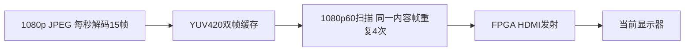

# C33/C36：EDID分析与1080p15输出路线

## 本轮结论

采集包中的第二台监视器 `HDMI / JRY0000` 对应 FPGA 使用的外接屏。它明确声明 **1920×1080逐行60Hz**，范围描述给出垂直58～62Hz、水平30～83kHz。

C33/C36的自定义1080p15扫描按参数计算为15Hz、16.5kHz，落在这份范围声明之外；C35的640×480/60Hz扫描为60Hz、33kHz，落在范围内，用户实测完整稳定彩条。已有证据使低刷新扫描的接收兼容性成为优先排查方向。发送端实际TMDS符号与完整时序尚待核验，故障根因闭环继续进行。

视频内容目标保持1920×1080、15fps。匹配该屏已列模式的一条明确路线是1080p60扫描，每个内容帧显示四次；它带来新的高速发射与内存扫描要求，需先落实硬件实现。

## 采集来源与身份

用户提供 `E:/QQ CACHE/Download/EDID_result_20261027_123105_181.zip`，并明确两台屏幕中一台是笔记本内屏、一台是FPGA外接屏。采集时间2026-10-27 12:31:05 +08:00。

ZIP SHA256：`9f442a0447b7b25cc5062529b4555538d0886720305f6524eced54eb4f605011`。

| 项目 | monitor01 | monitor02 |
| --- | --- | --- |
| Windows名称 | TL160ADMP11-0 | HDMI |
| 厂商/产品标识 | TMX1601 | JRY0000 |
| EDID长度 | 384B，3块 | 256B，2块 |
| 首选基础DTD | 2560×1600，约60Hz | 1920×1080，60Hz |
| 对应用途 | 笔记本内屏 | FPGA外接屏 |

用户口述内屏2560×1440；本次原始EDID首个DTD是2560×1600。身份结合用户给出的两屏组成、监视器名称及各自时序进行对应。

两份原始EDID的SHA256均与采集清单一致，全部5个128B块的校验和模256均为0，ZIP完整性检查通过。

外接屏EDID SHA256：`2312940357e065bc6fbbb017c364039dc15ebf30f4bd872f570a7dec2ee626b3`。笔记本内屏SHA256：`3d508bba6ff6eb6924c6cdf197fb05c8eb0f4d539cfbf9891f19afe19fce32f0`。

## 外接屏原始字段

### 首选1080p60

基础块偏移 `0x36` 的18字节DTD：

```text
02 3A 80 18 71 38 2D 40 58 2C 45 00 BA 88 21 00 00 1E
```

| 参数 | 解析值 |
| --- | --- |
| 像素时钟 | 148.5MHz |
| 有效区 | 1920×1080，逐行 |
| 总时序 | 2200×1125 |
| 水平前肩/同步/后肩 | 88 / 44 / 148像素 |
| 垂直前肩/同步/后肩 | 4 / 5 / 36行 |
| 行频 | 148.5MHz ÷ 2200 = 67.5kHz |
| 刷新率 | 148.5MHz ÷ 2200 ÷ 1125 = 60Hz |

这组数据与Linux DRM CTA模式表的VIC16一致。[Linux DRM CTA时序表](https://kernel.googlesource.com/pub/scm/linux/kernel/git/torvalds/linux/+/refs/heads/master/drivers/gpu/drm/drm_edid.c)

### 范围与时钟声明

基础块偏移 `0x5A` 的范围描述：

```text
00 00 00 FD 00 3A 3E 1E 53 10 00 0A 20 20 20 20 20 20
```

| 字段 | 声明值 |
| --- | --- |
| 垂直范围 | 58～62Hz |
| 水平范围 | 30～83kHz |
| 最大像素时钟 | 160MHz |
| HDMI VSDB最大TMDS时钟 | 225MHz |

范围结构和时钟倍率已核对Linux DRM EDID字段定义；最大像素时钟字段以10MHz为单位。[Linux DRM EDID结构](https://kernel.googlesource.com/pub/scm/linux/kernel/git/torvalds/linux/+/refs/heads/master/include/drm/drm_edid.h)

HDMI VSDB位于偏移`0x94`，payload为`03 0C 00 10 00 38 2D`，最大TMDS时钟字段`0x2D × 5MHz = 225MHz`。这里按HDMI链路时钟口径记录；下文的742.5MHz按本工程DDR串行器内部5倍时钟口径记录。

### 声明的主要视频模式

CTA短视频描述中有效编号为`16、5、4、3`，对应1080p60、1080i60、720p60、480p。其模式编号按Linux DRM CTA表复核。[模式编号来源](https://kernel.googlesource.com/pub/scm/linux/kernel/git/torvalds/linux/+/refs/heads/master/drivers/gpu/drm/drm_edid.c)

| 模式 | 本次EDID证据 |
| --- | --- |
| 1920×1080p60 | 基础DTD、标准时序、CTA VIC16原生标志 |
| 1920×1080i60 | CTA VIC5 |
| 1280×720p60 | CTA VIC4及扩展DTD |
| 1280×720p50 | 扩展DTD |
| 720×480p，名义60Hz | CTA VIC3；27MHz标准时序约59.94Hz |
| 1920×1080p50 / p30 / p24 / p15 | 本次EDID未列出 |

此外，标准时序还列了1680×1050、1440×900、1280×1024、1280×800等60Hz模式。

### EDID中的不一致

- 范围描述是58～62Hz，扩展DTD又列出720p50。
- CTA视频块含3个保留编号VIC0。

这些内容均保留在原始包和解析JSON中。后续优先采用明确的1080p60完整DTD，并结合输出端实际信号判断接收情况。

## 与三版实测对照

| 项目 | C33 / C36 | C35 | 外接屏声明 |
| --- | --- | --- | --- |
| 有效区 | 1920×1080 | 640×480 | 首选1920×1080 |
| 总时序 | 2000×1100 | 1000×550 | 首选2200×1125 |
| 像素/DDR串行时钟 | 33 / 165MHz | 33 / 165MHz | 首选像素148.5MHz |
| 行频，按参数计算 | 16.5kHz | 33kHz | 30～83kHz |
| 刷新率，按参数计算 | 15Hz | 60Hz | 范围58～62Hz |
| 用户反馈 | 无信号、随后无背光 | 完整稳定彩条 | — |

同33/165MHz链路在C35有成功实测；低刷新1080p扫描与屏幕声明的行频、垂直范围均有具体差异。C35同时改变了有效区、消隐和刷新率，发送端的核输出与握手情况继续留作核验项。

此前D0/D1/D3常亮、D2闪烁，分别对应PLL锁定、板内HDMI核输入相位锁定、启动完成及内部帧计数。现场接收证据以显示器画面和后续TMDS测量为依据。

## 后续实现预算

按屏幕已列的1080p60模式承载15fps内容：



| 环节 | 初步预算 / 当前证据 |
| --- | --- |
| 视频内容 | 保持1080p15，每帧66.667ms预算 |
| 像素时钟 | 148.5MHz，为33MHz诊断链的4.5倍 |
| 本PHY的DDR串行时钟 | 742.5MHz，为165MHz诊断链的4.5倍 |
| 每数据lane位率 | 1485Mbps |
| YUV420扫描读有效负载 | 186.624MB/s |
| 每秒15帧、1088行补齐的解码写负载 | 47.0016MB/s |
| 两者合计 | 233.6256MB/s，另需控制器/刷新/仲裁开销 |

现有模拟差分输出已在165MHz串行链获得C35成功反馈。DS300 v3.9.6第2.7.2节给出Emulated LVDS输出频率166MHz、True LVDS输出400MHz（800Mbps）；1080p60的高速发射实现是当前首要硬件门槛。器件、引脚及电气标准需要进一步具体核对。

赛题答疑要求HDMI输出驱动逻辑由FPGA侧实现；后续方案按此要求评估。原始答疑位于`E:/QQ CACHE/Download/安路资料/2026安路赛题一、二相关Q&A.docx`。

接下来先核对合规的高速发射实现与可用引脚，再确定显示扫描路线；发送端协议/实际时序验证同步保留。若进一步考虑1080p30扫描，需先取得目标显示器接受该逐行模式的实测。C34的15fps解码与原生YUV缓存离线证据继续保留。

## 产物与验证范围

- 原始ZIP留存：同目录`EDID_20261027/EDID_result_20261027_123105_181.zip`。
- 工程解析脚本：`E:/VSCODE-project/FPGA-ANLU/development/video33_work/edid_review/analyze_capture.py`。
- 完整JSON、两块原始EDID：`E:/VSCODE-project/FPGA-ANLU/development/video33_work/edid_review/capture_20261027_123105_181/`。
- 官方字段和CTA模式摘录：同工程目录`primary_field_reference.json`、`primary_mode_reference.json`。
- 根代理解析与gpt-6-luna独立逐字节复核一致；厂商码`2A59`经根代理复核为JRY，与Windows身份一致。

本轮完成EDID身份对应、原始数据校验、时序解析及路线预算；没有新增RTL、综合、位流或硬件操作。1080p15内容的整机播放目标仍在推进。

## 13:43更新：电脑1080p30实际接收已确认

- 用户提供完整Windows模式列表，初始1080仅60/59Hz；随后按NVIDIA手动时序1920×1080逐行30Hz、2200×1125、74.25MHz测试。参数页与Windows桌面/活动信号均一致，用户明确外接屏桌面约20秒“完整稳定，没有闪烁或无信号”。该屏1080p30接收现有实际证据，EDID范围/模式未列情况保留为固件声明遗漏。三张原截图与结构化证明在EDID_20261027/pc1080p30_*。
- 因EDID已漏列30Hz，根进一步请求电脑按C33/C36完全相同33MHz/2000×1100/15Hz/HFP8/HSA8/VFP4/VSA5/负负同步测试，以区分目标接收与FPGA发射实现；结果待用户。指南已增补阶段二，项目deliverables/monitor_1080p30_test_20261027.md。
- 高速硬件审查：DS300 PLL输出4–400MHz/VCO300–1200MHz，TrueLVDS400MHz/800Mbps，现HDMI四P脚原生标准均被TD既有探针拒绝而Emulated标准通过；原生候选P4的四对GPIO经图纸核对可复用，当前播放器未用，但电气/PCB/TD原生标准与到HDMI路径仍待核验。50MHz参考M104/N7、C0=10/C1=2是74.285714/371.428571MHz近似候选（+0.0481%），27MHz精确方案仅备选。
- C35门级引脚恢复1.2M字已完成，锁后649个H周期全1000，580行全640、帧起点550000字、371200RGB仅首锁定行7个边界像素差/后续0；一位负控正确检出额外后续1RGB错误。发现数据岛payload96符号、C36水平blank80的潜在调度约束，C36实际长回放仍待解码，未定根因。
